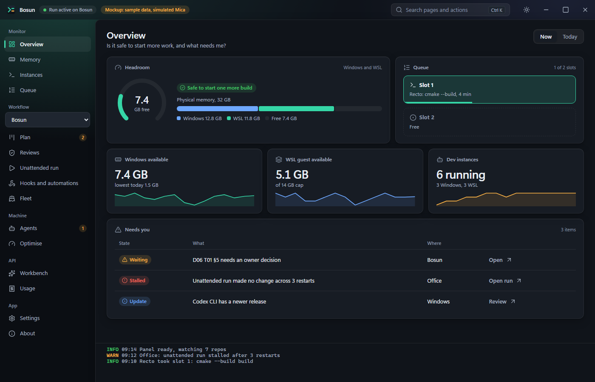

<div align="center">


# Bosun

**Run more repos on the same RAM. Heavy jobs take turns across Windows and WSL, and a logger records what each repo really uses.**

[](https://github.com/rizonetech/Bosun/actions/workflows/build.yml)
[](https://github.com/rizonetech/Bosun/actions/workflows/plan.yml)
[](LICENSE)


[Quick start](#how-do-i-build-and-install-it) · [Usage](#how-do-i-use-it) · [Panel preview](#what-is-being-built-next) · [Contributing](CONTRIBUTING.md) · [Security](SECURITY.md)

</div>

## Why does Bosun exist?

Several repos and agent sessions can share a machine until their builds overlap. Then Windows and the WSL VM compete for the same memory, and everything stalls. Bosun makes the heavy commands queue across both sides, without closing a session or an editor.

- **One queue for two operating systems:** `bosun run` works the same on Windows and in WSL, and both sides share the same slots.
- **Admission by real memory:** a second job starts only when there is room for it.
- **Crash safe:** slots are held by operating system objects, so a crashed job frees its slot at once.
- **Evidence before hardware:** the logger shows which repo used what, so a decision like buying more RAM rests on measured peaks.
- **Light and private:** two small native tools with no runtime to install, no admin rights and no network use.

## What works today?

| Part | State |
| ---- | ----- |
| `bosun run`, `status`, `report` and the login logger | Working on Windows 11 and WSL 2 |
| WSL shim and `bosun-log` user service | Working |
| Bosun Panel, the desktop control panel | Designed and planned, not built yet |

There are no releases yet, so you build from source.

## How do I use it?

Put `bosun run --` in front of heavy commands, on Windows or in WSL:

```
bosun run -- npm test
bosun run -- msbuild App.sln /m:4
bosun status
bosun report --days 7
```

Sessions and editors stay open as normal. Only commands wrapped in `bosun run` queue. Do not wrap dev servers or watchers, because they would hold a slot for as long as they run.

## How does the queue decide?

- There are 2 slots by default, shared by Windows and WSL.
- The first slot always admits a job. The second needs 6 GB available on Windows, and in WSL also 3 GB available inside the VM.
- After 15 minutes a waiting job starts anyway, with a warning.
- A crashed job frees its slot immediately.

Change the defaults with `--slots`, `--min-avail-mb` and `--max-wait`, or `BOSUN_SLOTS`, `BOSUN_MIN_AVAIL_MB` and `BOSUN_MAX_WAIT`. In WSL, `--min-guest-mb` or `BOSUN_MIN_GUEST_MB` sets the VM threshold.

## What stops a job from filling the disk?

A job and everything it starts end together, and together they may write at most 100 GB. A job over that budget is stopped, children and all, and `bosun run` exits 74 and says why. A command that writes without end, such as a test whose fake child floods a log, would otherwise fill the drive, and a full system drive takes Windows and the WSL disk image on it down with it. Change the budget with `--max-write-gb` or `BOSUN_MAX_WRITE_GB`, and 0 turns it off.

- **Windows:** the job object that holds the command counts what every process in it writes, and closing it ends anything the command left behind. Windows keeps no per-job count of disk writes alone, so bytes written to pipes count too, which is why the default is generous.
- **WSL:** the command runs in its own systemd scope, a nested run and one without a slot included, and anything it leaves behind is stopped when it ends. systemd gives user jobs the `io` controller only through a root setting, so turn the budget on once with `sudo ~/.local/share/bosun/enable-write-budget.sh`, then `wsl --shutdown`. Until then the budget is off in WSL, and `bosun run` says so once per boot. The budget counts writes to the Linux disk only: writes to a Windows drive through `/mnt/c` travel over the host file share, which Linux does not count.

## Where are the logs?

`%LOCALAPPDATA%\Bosun\logs`, one CSV per side per day, sampled every 30 seconds and kept for 14 days. A process is credited to the git repo holding its working directory, otherwise to its parent's repo.

## How do I build and install it?

Needs Visual Studio (or its Build Tools) with the C++ tools, which bring CMake and Ninja. `scripts/build.ps1` loads the compiler environment itself, so any shell works. The WSL side expects an `Ubuntu` distro, and `-Distro` picks another. No admin rights are needed.

```
pwsh scripts/build.ps1
pwsh scripts/install.ps1
```

A Release build copies only `bosun.exe` and `bosun-logger.exe` to `bin/`, and everything else, including test binaries and PDBs, stays in `build/`. Both folders are ignored by Git.

The installer takes the tools from `bin/` and copies them to `%LOCALAPPDATA%\Bosun\bin`, adds that folder to your user PATH, starts the logger at login and sets up the `bosun-log` user service in WSL.

Installing again while other repos have jobs running is safe. Each running exe is renamed aside and the new one takes its name, so a job already running finishes on the old image and the next `bosun run` starts the new one. The logger restarts with a gap of about a second. The slots keep their names, so old and new jobs share the same queue.

## How do I test it?

```
build\Release\test_core.exe
pwsh tests\queue_test.ps1
pwsh tests\stage_wsl_test.ps1
pwsh tests\bin_output_test.ps1
pwsh tests\build_cache_test.ps1
pwsh tests\swap_file_test.ps1
wsl -- python3 -B tests/test_bosun_log.py
wsl -- bash wsl/queue_test.sh "$(wsl wslpath -a build/Release/bosun.exe)"
```

The queue tests use a private slot namespace, so they do not affect real jobs. On a machine without WSL, `tests\queue_test.ps1 -SkipWsl` leaves out the WSL case, as CI does.

The WSL commands read the repo through its drive's mount under `/mnt`, which WSL sets up when it starts. If the mount is missing after adding a drive, restart WSL. `pwsh scripts/install.ps1` does not need it.

The design is in `docs/specs/2026-11-07-bosun-design.md`.

## What is being built next?

Bosun Panel, a .NET 11 WPF control panel for memory, dev instances, the queue and machine tuning. It shows what the tools above measure and needs nothing else: no other repo, no agent workflow and no API key. This image comes from the design [mockup](design/mockups/control-panel.html), with sample data and a simulated Mica backdrop. The panel itself is not built yet.



See the [design](docs/specs/2026-11-07-control-panel-design.md), the [interface spec](design/SPEC.md) and the [plan](todo/implementation-plan.md).

## How is the project run?

Work follows a validated TODO graph in [`todo/`](todo/TODO-00-INDEX.md), and changes are recorded in the [changelog](CHANGELOG.md). [CONTRIBUTING.md](CONTRIBUTING.md) explains how to take part, and [SECURITY.md](SECURITY.md) explains how to report a vulnerability privately.

## License

Copyright (C) 2026 Rizonetech (Pty) Ltd. Bosun is free software under the [GNU General Public License, version 3 or later](LICENSE). Third-party components are listed in [NOTICE.md](NOTICE.md).
